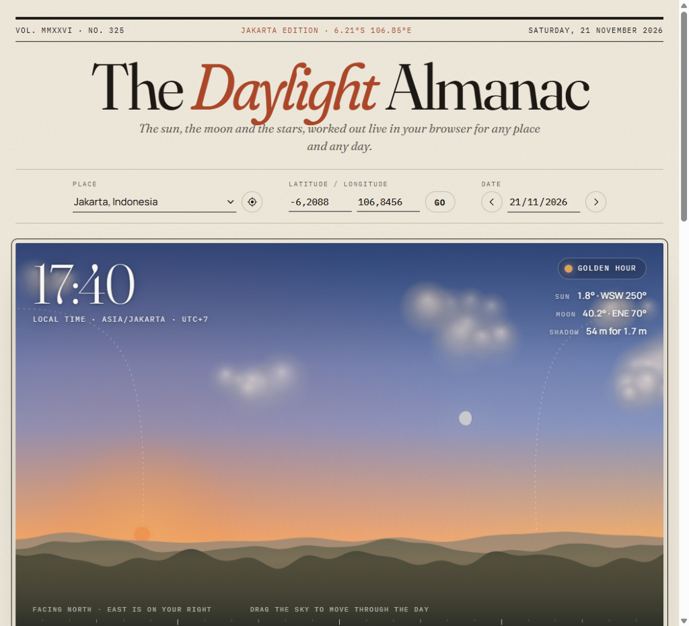

<div align="center">


# ☀️ The Daylight Almanac

**The live sky, anywhere on Earth.** A zero-dependency astronomical almanac that renders the real sun, moon, twilight bands, and sidereal starfield for any place and date — styled like a printed editorial broadsheet that shifts from warm paper by day to deep observatory ink at night.

[](./index.html)
[](./css/styles.css)
[](./js/astro.js)
[](./docs/ARCHITECTURE.md)
[](./LICENSE)

<br />



</div>

---

## ✨ Highlights

| Icon | Feature | Description |
| :---: | --- | --- |
| 🌅 | **Physically-Driven Sky Panorama** | Real-time 360° Canvas 2D sky with solar-altitude gradients, sunset glow, Belt of Venus anti-twilight, drifting clouds, parallax ridges, solar arc, and cardinal compass rose. |
| 🌟 | **Real Sidereal Starfield** | **29 named bright stars** (*Sirius, Canopus, Betelgeuse, Rigel, Vega, Polaris, Acrux, Fomalhaut…*) plus **700 seeded background stars** that wheel accurately around the celestial pole. |
| 🌓 | **Hemisphere-Accurate Moon** | Renders the live lunar disc, phase name, illuminated percentage, synodic age, Earth–Moon distance, rise/set pins, and upcoming full & new moon dates — automatically flipped for the southern hemisphere. |
| 🕰️ | **Drag-the-Sky & Twilight Scrubber** | Grab and drag directly across the sky panorama, scrub the 24-hour twilight color band with event pins, run time-lapse playback (`10 min/s`, `1 hr/s`, `4 hr/s`), or snap back to **Now**. |
| 📰 | **Dynamic Day / Night Broadsheet** | Editorial typography (`Fraunces`, `Manrope`, `IBM Plex Mono`) that automatically transitions between warm almanac paper (`day`) and nocturnal observatory ink (`night`) as the sun dips past `−4°`. |
| 📈 | **Interactive Year in Daylight** | Analytic 365-day daylight curve with exact solstice dates, **midnight sun** plateaus, and **polar night** troughs — hover any day or click the curve to jump straight to that date. |
| 🌍 | **Anywhere on Earth** | 13 curated presets (equator to Arctic & Antarctica), custom latitude/longitude coordinates, and one-click browser geolocation with DST-aware local timezones. |

---

## 🌤️ Twilight & Light Phases

| Swatch | Phase | Solar Altitude | What You See Outside |
| :---: | --- | :---: | --- |
| 🟨 | **Daylight** | `≥ +6°` | Broad daylight, crisp shadows, daytime moon when bright & high |
| 🟧 | **Golden Hour** | `−4°` to `+6°` | Low-angle amber sunlight, long shadows, lit cloud undersides |
| 🟦 | **Blue Hour** | `−6°` to `−4°` | Cool cobalt sky illuminated solely by upper-atmosphere scattering |
| 🔷 | **Nautical Twilight** | `−12°` to `−6°` | Sea horizon remains visible while brightest navigational stars emerge |
| 🟣 | **Astronomical Twilight** | `−18°` to `−12°` | Sky appears black to the eye, though faintest stars are still fading |
| ⬛ | **True Night** | `< −18°` | Zero solar glow — full dark-sky visibility |

---

## 🧭 Curated Places Included

| Region | Locations | Why Try It |
| --- | --- | --- |
| 🌴 **Tropics & Equator** | Jakarta, Denpasar (Bali), Singapore, Quito | Near-constant ~12 h days all year; overhead noon sun & tiny shadows |
| 🏙️ **Mid-Latitudes** | Tokyo, London, New York, Cape Town | Dramatic seasonal swings (`~8 h` winter to `~16.6 h` summer) + northern vs. southern hemisphere orientation |
| 🧊 **Polar Extremes** | Reykjavík, Tromsø, Longyearbyen (Svalbard), Ushuaia, McMurdo Station | Midnight sun plateaus, polar night continuous midday twilight, and grazing horizons |

---

## ⌨️ Keyboard Shortcuts

| Shortcut | Action |
| :---: | --- |
| `←` / `→` | Step time backward / forward by **5 minutes** |
| `Shift` + `←` / `→` | Step time backward / forward by **1 hour** |
| `Space` | Toggle time-lapse **Play / Pause** |
| `N` | Jump back to live **Now** |
| `[` / `]` | Jump to **previous / next day** |

---

## 📁 Project Structure

```text
daylight-almanac/
├── index.html              # Semantic broadsheet layout, controls & ephemeris columns
├── LICENSE                 # MIT License
├── README.md               # Project overview & quickstart
├── assets/
│   ├── favicon.svg         # Custom twilight horizon SVG icon & favicon
│   └── preview.png         # Golden-hour broadsheet screenshot preview
├── css/
│   └── styles.css          # Editorial print layout, day/night themes & responsive grid
├── docs/
│   └── ARCHITECTURE.md     # Full technical architecture, formulas & extension guide
└── js/
    ├── astro.js            # Zero-dependency solar/lunar ephemeris & Intl timezone engine
    ├── sky.js              # 9-layer Canvas 2D panoramic sky, clouds, moon & starfield renderer
    └── app.js              # App state, scrubber/drag controls, field notes & year curve SVG
```

> 📖 **Full Technical Documentation:** Read [`docs/ARCHITECTURE.md`](./docs/ARCHITECTURE.md) for the system diagram, coordinate transformation formulas, 9-layer sky rendering order, polar twilight handling, and guides for adding new places or stars.

---

## 🚀 Getting Started

No build step, no `npm install`, and no external API keys required. Open `index.html` directly in your browser, or run any lightweight static server:

```bash
# Clone the repository
git clone https://github.com/Freddy47588/daylight-almanac.git
cd daylight-almanac

# Option 1: Python
python -m http.server 8742

# Option 2: Node.js
npx serve -l 8742
```

Then visit **`http://localhost:8742`** in your browser.

---

## 🌐 Deployment

100% static HTML, CSS, and JavaScript — deploy directly to **GitHub Pages** (`Settings → Pages → Source: Deploy from branch main / root`), **Cloudflare Pages**, **Netlify**, or **Vercel**.
