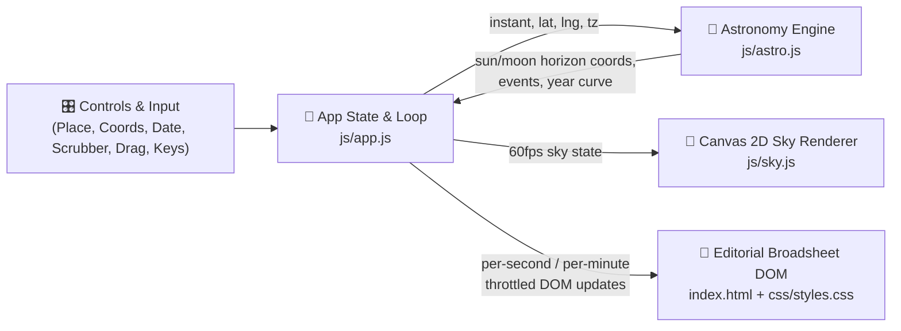

# 📐 Architecture — The Daylight Almanac

This document describes the internal architecture, astronomical pipeline, Canvas 2D sky rendering layers, theming system, and extension points of **The Daylight Almanac**.

---

## 🗺️ System Overview

The application is intentionally **100% client-side, zero-dependency, and build-free**. All scripts expose clean globals (`window.Astro`, `window.Sky`, `window.SkyUtil`) so the project runs identically over HTTP (`python -m http.server`, GitHub Pages) or opened directly via `file://`.



---

## 🔭 1. Astronomy Engine (`js/astro.js`)

`js/astro.js` implements low-precision solar and lunar ephemeris theory (matching *Astronomy Answers*, `aa.quae.nl`) with zero external timezone or ephemeris tables.

### Coordinate Transformation Pipeline

1. **Julian Days since J2000** (`toDays(ms)`): Converts UTC epoch milliseconds to fractional days relative to `J2000.0` (`2451545`).
2. **Equatorial Coordinates** (`sunCoords(d)`, `moonCoords(d)`):
   - Computes solar mean anomaly $M$, equation of center $C$, ecliptic longitude $L$, then projects to Right Ascension ($\alpha$) and Declination ($\delta$) using Earth's obliquity $\varepsilon = 23.4397^\circ$.
   - Computes lunar ecliptic longitude, latitude, and Earth-Moon distance (km) with main perturbation terms.
3. **Local Horizon Projection** (`horizon(ms, lat, lng, ra, dec)`):
   - Computes Local Sidereal Time $\theta$, Hour Angle $H = \theta - \alpha$, and converts to local **altitude** and **azimuth** (clockwise from true north, `0°–360°`).
   - Applies standard atmospheric refraction to lunar altitude.
4. **Lunar Illumination & Phase Solver** (`moonIllumination`, `nextPhase`):
   - Solves the Sun–Moon–Earth phase angle to obtain illuminated fraction (`0..1`), phase cycle (`0..1`), and lunar age in synodic days (`29.530588853 d`).
   - `nextPhase(from, target)` scans forward in 6-hour steps and refines zero-crossings via 20 iterations of bisection.

### Event Finding & Polar Edge Cases

- **Daily Solar Events** (`sunDay(start, end, lat, lng)`): Samples solar altitude every **1 minute** across the DST-aware local day (`zonedMidnight(y, m, d, tz)` to `zonedMidnight(y, m, d + 1, tz)` via `Intl.DateTimeFormat`), linearly interpolating threshold crossings.
  - Naturally detects **Midnight Sun** (`polar: 'midnight-sun'`) and **Polar Night** (`polar: 'polar-night'`) when no horizon crossing occurs.
  - Integrates exact fractional day length across the horizon boundary.
- **365-Day Year Curve** (`quickDayLength(start, lat, lng)`): Evaluates the analytic hour-angle formula at local solar noon:

  $$\cos H_0 = \frac{\sin(-0.833^\circ) - \sin\phi\sin\delta}{\cos\phi\cos\delta}$$

  Clamping `cosH <= -1` to `1440` min (24 h) and `cosH >= 1` to `0` min (0 h). This runs in under 1 ms for a full year and resolves solstices to the exact calendar day.

### Solar Altitude Thresholds

| Phase | Solar Altitude Range | Meaning |
| --- | :---: | --- |
| **Daylight** | `≥ +6°` | Direct daylight above golden hour |
| **Golden Hour** | `−4°` to `+6°` | Warm low-angle sunlight & elongated shadows |
| **Sunrise / Sunset** | `−0.833°` | Upper solar limb touches geometric horizon (includes refraction + semidiameter) |
| **Blue Hour** | `−6°` to `−4°` | Deep cobalt sky illuminated by upper-atmosphere scattering |
| **Nautical Twilight** | `−12°` to `−6°` | Horizon line discernible at sea alongside bright navigational stars |
| **Astronomical Twilight** | `−18°` to `−12°` | Faintest stars begin fading / emerging |
| **True Night** | `< −18°` | Zero solar contribution to sky luminance |

---

## 🌌 2. Sky Panorama Renderer (`js/sky.js`)

`Sky` renders a DPR-aware, 360° panoramic projection onto `#sky`, centered on the equator-facing cardinal direction (**South** in the northern hemisphere, **North** in the southern hemisphere).

### 9-Layer Painter's Order

1. **Altitude-Keyed Sky Gradient** — Interpolates Zenith, Mid-Sky, and Horizon stops across a 12-anchor solar altitude palette (`−90°` to `+90°`), filling the full canvas height so no stale pixels ever appear beneath low hill valleys.
2. **Horizon Scattering & Belt of Venus** — Gaussian-weighted radial warm glow aligned with the sun's azimuth near the horizon, paired with a subtle rose-violet anti-twilight band (`180°` opposite).
3. **Real Sidereal Starfield** — Projects **29 named bright stars** (J2000 RA/Dec + visual magnitude, from Sirius `−1.46` to Polaris `+1.98`) and **700 deterministic faint background stars** onto the live local horizon with atmospheric extinction near `0°` altitude and subtle scintillation.
4. **Daily Solar Arc** — Subtle dashed curve tracing the sun's full path above `−2°` for the active date.
5. **Drifting Clouds** — 7 multi-puff procedural cloud clusters tinted dynamically by daylight and sunset glow.
6. **Phase-Accurate Moon Disc** — Draws earthshine, atmospheric halo, and exact crescent/gibbous terminator geometry (`litPath`), flipped horizontally in the southern hemisphere.
7. **Solar Disc & Corona Halo** — Color-shifts from crisp cream-white overhead to deep tangerine near the horizon, expanding its atmospheric scattering halo at low altitudes.
8. **Parallax Horizon Ridges** — 3 procedural harmonic mountain layers shaded by daylight/twilight/night color mixes and atmospheric perspective haze.
9. **Ground Mist & 360° Compass Rose** — Subtle foreground vignette and `15°` / `45°` cardinal bearing ticks (`N`, `NE`, `E`, `SE`, `S`, `SW`, `W`, `NW`).

---

## 📰 3. State Orchestration & Editorial Broadsheet (`js/app.js` & `css/styles.css`)

- **Frame Loop (`requestAnimationFrame`)**: Redraws the canvas smoothly at 60 fps (for twinkling stars, cloud drift, and time-lapse playback) while throttling DOM updates (`updateDom`) to change keys (`1 s` in Live mode, `1 min` while scrubbing).
- **Dynamic Day / Night Broadsheet Theme**: Switching `body[data-theme]` at `sun.altitude < -4°` smoothly transitions CSS custom properties (`--paper`, `--ink`, `--muted`, `--rule`, `--accent`, `--moon-dark`) and `<meta name="theme-color">` in `0.45s`. Initial paint suppresses transitions via `.no-trans` to eliminate light-to-dark flash on night loads.
- **Polar Twilight Continuity**: In `renderLight()`, when high-latitude days enter Golden Hour or Blue Hour without exiting upward (e.g. Tromsø in November/December), the continuous midday window is split cleanly at `solarNoon` across Morning and Evening columns.
- **Direct Manipulation**:
  - Pointer-capture dragging directly on `#sky` scrubs time (direction-aware for northern vs. southern hemisphere orientation).
  - Hovering/clicking `#yearChart` previews any day of the year and jumps directly to that date.
  - Last selected place is persisted in `localStorage` (`daylight-almanac.place`).

---

## 🧩 4. Extending the Project

### Adding a Curated Place
Append an entry to `PLACES` in [`js/app.js`](../js/app.js):

```js
{ id: 'kyoto', name: 'Kyoto', region: 'Japan', lat: 35.0116, lng: 135.7681, tz: 'Asia/Tokyo' }
```

Use any valid IANA timezone identifier supported by `Intl.DateTimeFormat`.

### Adding Named Stars
Add `[name, raDeg, decDeg, visualMagnitude]` to `NAMED` in [`js/sky.js`](../js/sky.js), and optionally include `name` in the `LABELLED` set to display its uppercase monospace label at night.

### Adjusting the Editorial Palette
Edit the CSS custom properties in `:root` (day paper theme) and `body[data-theme='night']` (night observatory theme) at the top of [`css/styles.css`](../css/styles.css).
